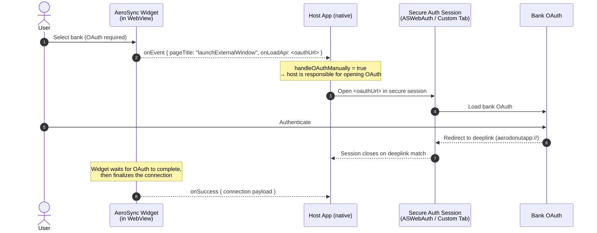
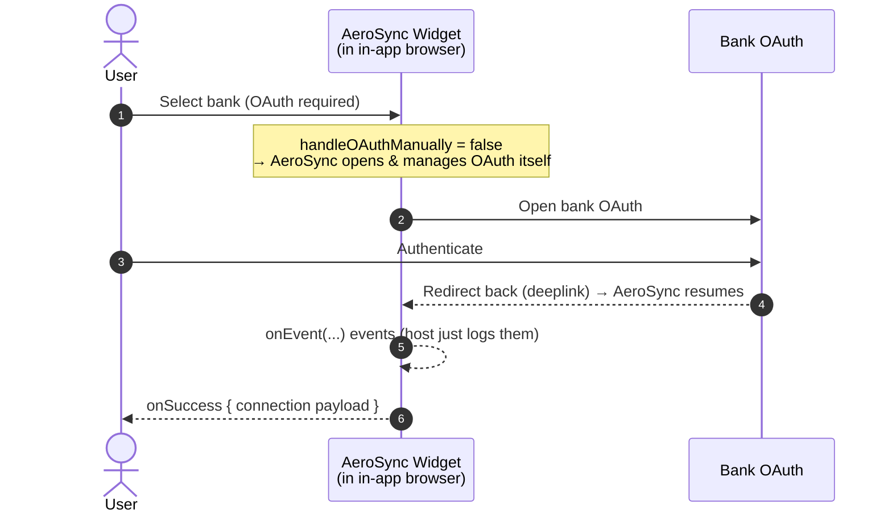

# AeroSync Hybrid Integration — Design Overview

Two ways to embed the AeroSync widget in a mobile app. Both walk the user through
the same onboarding UI; the **only** difference that matters to the AeroSync
integration is **how OAuth is handled**, which is driven by a single widget config:
`handleOAuthManually`.

| | **Option 1 — Embedded** | **Option 2 — Direct Sign-up** |
|---|---|---|
| Container for the web UI | Native **WebView** (in-app) | System **in-app browser** (Custom Tab / SFSafariViewController) |
| `handleOAuthManually` | `true` | `false` |
| Who opens the OAuth window | The **native app** (secure session) | **AeroSync** (handled internally) |
| Widget event you must act on | `onEvent` → `launchExternalWindow` (OAuth URL) | none (just log `onEvent`) |
| Completion signal | `onSuccess` (after OAuth returns via deep link) | `onSuccess` |

> `handleOAuthManually: true` is the switch. When `true`, AeroSync does **not**
> open the bank OAuth page itself — it emits the URL and expects the host to open
> it (so the app can use a secure, system-provided auth session). When `false`,
> AeroSync opens and manages OAuth itself.

---

## Option 1 — Embedded (WebView), `handleOAuthManually: true`

AeroSync emits the OAuth URL; the native app opens it in a secure auth session
(ASWebAuthenticationSession on iOS / Custom Tab on Android). OAuth returns to the
app via the `deeplink` scheme, the widget resumes, and `onSuccess` fires.



### AeroSync widget config — Option 1

```js
window.aerosync.initWidget({
  elementId: 'widgetId',
  iframeTitle: 'Connect',
  environment: 'sandbox',            // or 'production'
  token: 'YOUR_AEROSYNC_TOKEN',      // AeroSync token (NOT an AeroPay token)
  aeroPassUserUuid: 'YOUR_USER_UUID',

  // Deep link AeroSync redirects to when OAuth completes. The secure auth
  // session is configured to close on this scheme.
  deeplink: 'yourapp://',

  // KEY DIFFERENCE: the host opens the OAuth window, not AeroSync.
  handleOAuthManually: true,

  onEvent: (event) => {
    // When handleOAuthManually is true, AeroSync surfaces the OAuth URL here.
    // Forward it to the native layer to open in a secure auth session.
    if (
      event?.payload?.pageTitle === 'launchExternalWindow' &&
      event?.payload?.onLoadApi
    ) {
      const oauthUrl = event.payload.onLoadApi;
      // Hand oauthUrl to the native app (e.g. via WebView postMessage).
      // The native app opens it in ASWebAuthenticationSession / Custom Tab.
    }
  },

  onLoad: () => {},
  onSuccess: (event) => {
    // Fires after OAuth returns and the connection is finalized.
  },
  onClose: () => {},
  onError: (error) => {},
});
```

---

## Option 2 — Direct Sign-up (in-app browser), `handleOAuthManually: false`

The whole web UI runs in the system in-app browser. AeroSync opens and manages
OAuth itself; the host does nothing special with `onEvent`. `onSuccess` signals
completion.



### AeroSync widget config — Option 2

```js
window.aerosync.initWidget({
  elementId: 'widgetId',
  iframeTitle: 'Connect',
  environment: 'sandbox',            // or 'production'
  token: 'YOUR_AEROSYNC_TOKEN',
  aeroPassUserUuid: 'YOUR_USER_UUID',

  deeplink: 'yourapp://',

  // KEY DIFFERENCE: AeroSync opens & manages OAuth internally.
  handleOAuthManually: false,        // (this is also the default)

  onEvent: (event) => {
    // No special handling required — log for observability.
    console.log('onEvent', event);
  },

  onLoad: () => {},
  onSuccess: (event) => {
    // Fires when linking completes.
  },
  onClose: () => {},
  onError: (error) => {},
});
```

---

## Notes for the integrator

- **`handleOAuthManually` is the only functional switch** between the two flows on
  the AeroSync side. Everything else (WebView vs in-app browser, how you route to
  your success screen) is host-app concern.
- **`deeplink`** must match a URL scheme your app registers (Android intent-filter,
  iOS `CFBundleURLTypes`). It's how OAuth returns to the app in both options.
- **Option 1 OAuth URL** arrives as `onEvent.payload.onLoadApi` with
  `onEvent.payload.pageTitle === 'launchExternalWindow'`. Open that URL in a
  secure system auth session so credentials never touch the app/WebView.
- **`token`** is an AeroSync token — do **not** pass an AeroPay token.
- **`onSuccess`** is the completion signal for both options; use its payload to
  drive your post-linking UI.
